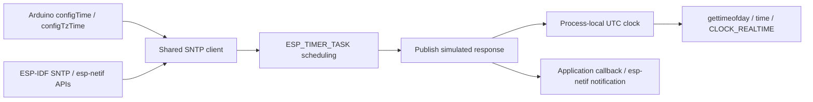

# SNTP emulation

Status: Implementation in progress. Stages 1-3 provide the clock bridge, shared
client, and Arduino integration; esp-netif and release coverage follow.

## Objective

Run ordinary ESP32 Arduino and ESP-IDF time-synchronization code in the emulator,
with controllable successful and missing server responses, observable clock
updates, SoC-like unsynchronized startup, and synchronization callbacks
delivered from task context.

## Motivation

The roo_time `Esp32NtpTime` example currently substitutes a host-only
`StartClock()` implementation. On a board it registers an SNTP callback and
calls `configTime()`. On the host it reads host time and explicitly invokes its
own callback. Application examples should be able to teach the platform APIs
without implementing this workaround themselves.

The first useful outcome is simple: register the usual callback, call
`configTime(0, 0, "pool.ntp.org")`, wait normally, and receive a simulated
synchronization notification. Tests also need to delay or suppress that
notification and verify that a clock correction actually reaches application
clock reads.

## Background

The destination-owned [Arduino time shim](../roo_testing/frameworks/esp32_shims/arduino_time.cpp)
implements `configTime()`, `configTzTime()`, and `getLocalTime()`. The first two
currently initialize networking and configure the process timezone, ignoring
server arguments. `getLocalTime()` reads the host's C clock. There is no
host SNTP implementation providing synchronization notifications.

The imported [Arduino implementation](../roo_testing/frameworks/arduino-esp32/cores/esp32/esp32-hal-time.c)
shows the expected stop/configure/start sequence. The imported
[ESP-IDF SNTP header](../roo_testing/frameworks/esp-idf/components/lwip/include/apps/esp_sntp.h)
and [implementation](../roo_testing/frameworks/esp-idf/components/lwip/apps/sntp/sntp.c)
define important compatibility details: several `esp_sntp_*` spellings are
macros for `sntp_*` symbols, completed status is consumed by reading it, and
the update interval has a 15-second minimum. The
[esp-netif adapter](../roo_testing/frameworks/esp-idf/components/esp_netif/lwip/esp_netif_sntp.c)
adds initialization, waiting, and sync events above that global client.

Applications using roo_time's `SystemClock` call `gettimeofday()`; Arduino
`getLocalTime()` calls `time()`. A private SNTP timestamp alone would leave
these APIs observing a different clock. Calling the real Linux `settimeofday()`
would attempt to change the machine's clock and is unsuitable for emulation.

The default must represent a fresh power-on with no retained RTC time. In
[ESP-IDF 6.0.2's C time implementation](https://github.com/espressif/esp-idf/blob/v6.0.2/components/esp_libc/src/time.c),
clock reads combine a stored UTC origin with elapsed device time; reading the
clock does not itself synchronize it. The
[system-time guide](https://docs.espressif.com/projects/esp-idf/en/v6.0.2/esp32/api-reference/system/system_time.html#overview)
also distinguishes power-on reset from resets/sleep that can retain RTC time.
This plan targets the cold-boot state by default and documents retained-clock
scenarios separately.

The existing [emulated clock](emulated_time_clock.md) provides monotonic uptime.
The [alarm service](emulated_time_alarms.md) delivers low-level work from an
explicit pump or native worker; it forbids running public application callbacks
there. The existing [ESP timer adapter](esp_timer_emulation.md) already bridges
alarms into `ESP_TIMER_TASK` callbacks. Both Arduino and IDF runners initialize
that service before application code.

## Requirements

1. Support the normal Arduino and ESP-IDF SNTP entry points across ESP32,
   ESP32-S3, and ESP32-C3, sharing one implementation.
2. Make synchronization update a process-local wall clock visible to application
   C time reads; never change the host machine's time or emulated uptime.
   Before any clock set or successful sync, expose Unix epoch plus elapsed
   emulated time, without an implicit host-date seed or synthetic read error.
3. Deliver notifications asynchronously in a normal FreeRTOS task, after
   publishing the clock update. Permit callbacks to inspect status and stop or
   restart synchronization without deadlocking.
4. Provide a useful default for examples with no real DNS, UDP, or Internet
   dependency, plus repeatable reference-time, delayed-response, and no-response
   scenarios for tests.
5. Work with both host-following and manual emulated uptime. Merely reading a
   clock must not run a synchronization callback or advance time.
6. Define stop, restart, reset, and shutdown behavior so tests cannot inherit
   callbacks, timers, or server configuration from previous cases.
7. Preserve timezone formatting and distinguish a readable clock from evidence
   of successful synchronization. Reject unsupported modes explicitly.

## Design Overview

Use a simulated server response above the existing timer service. No NTP wire
protocol is needed for this release. Server names and addresses are client
configuration; one configurable virtual server behavior supplies their time.

Three pieces satisfy the requirements:

| Piece | Responsibility |
| --- | --- |
| Process-local wall clock | Provide one UTC clock to application C reads, progressing with emulated uptime and allowing steps without affecting the host clock |
| Shared SNTP client | Own configuration, schedule responses/polls, publish updates, expose status, and deliver callbacks in task context |
| Thin framework adapters | Connect Arduino and esp-netif APIs to that client while preserving their own timezone, waiting, and event contracts |



The device starts unsynchronized, with its clock counting from the Unix epoch
at emulated power-on. A configured virtual server responds after 100 ms of
emulated uptime with current real host UTC by default. Host time is a server
response source only; it becomes device time after a successful synchronization.
Tests select a reference UTC instant or silence through the host control API.
These choices control server behavior, not the firmware API. A normal example
needs no host-specific synchronization branch.

## Design Details

### One wall clock, separate from uptime

Add a framework-independent `roo_testing/system/wall_clock.{h,cpp}`. Store a UTC
microsecond reading together with the emulated uptime at which it was set.
Subsequent readings add the elapsed emulated uptime. A synchronization steps
this UTC mapping; it never rebases the monotonic clock or its pending deadlines.

Initialize the UTC reading and its uptime anchor to zero at the existing
emulated boot origin. Before a clock set, `utc_us = system_time_get_micros()`:
1970-01-01T00:00:00Z plus elapsed emulated time. Initialize this mapping
independently of its first read; reading at five seconds must return five
seconds after the epoch, not restart the clock at zero. By application startup,
the timer can already be nonzero. Exact ROM/bootloader execution time and RTC
oscillator drift are outside this abstraction.

`gettimeofday()` succeeds in this state; `time()` returns the corresponding
whole epoch seconds. There is no invented invalid timestamp, failing read, or
separate clock-ready flag inside the C time APIs. In roo_time, a successful
`SystemClock::now()` therefore has `isSet() == true` even before synchronization.
Arduino `getLocalTime()` retains its platform year heuristic and normally times
out during unsynchronized startup. SNTP status remains RESET and its callback
has not fired. These are distinct observations; a successful time read is not
proof of synchronization.

The device UTC mapping changes only through an explicit clock set or a delivered
server response. Registering a callback, configuring a server, starting the
client, changing `TZ`, reading time, or receiving no response must not seed it
from host time. Stopping/restarting/resetting the SNTP client retains the
existing UTC mapping; the device clock keeps ticking after a successful sync,
even when the server later becomes silent.

Host-following and manual modes retain their existing immutable uptime policy.
They control progression, not calendar initialization. Each new emulator process
represents a fresh cold boot. A deliberately pre-set clock is an explicit fixture
using the time-setting API; neither the default nor a hidden compatibility mode
provides host-initialized device time.

Use the existing `SchedulerSafeHostLock` for this small mapping because native
host code and FreeRTOS tasks can both read it. Do not dispatch callbacks, change
`TZ`, or call SNTP while holding this lock. Arithmetic and conversions are
checked, including negative epochs, normalization, `time_t` conversion, and
nanosecond scaling. POSIX wrappers return `EOVERFLOW` on an unrepresentable
result; test-control setters reject an invalid mapping without changing it.

Expose host controls to set UTC and to restore the default power-on mapping.
Restoring that mapping clears the UTC correction while preserving current
uptime: it yields epoch plus the elapsed time of this same emulated boot,
not a new boot or an uptime rewind.
A server's reference timeline is separate from the device clock: deliberately
setting the device clock incorrectly must not also change the server's time.

### Startup and synchronization acceptance cases

Use a manual-time binary with a fresh process for the exact startup baseline.
The following are required observations, not optional fixture settings:

| Action/state | Device clock and synchronization observations |
| --- | --- |
| Power-on, uptime zero | `gettimeofday()` succeeds at epoch; `time()` is zero; sync status RESET; no callback |
| First read after advancing 2.5 s | UTC is 1970-01-01T00:00:02.500000Z, including subsecond progression |
| Client configured but response pending | Device continues counting from epoch; no callback or completed status |
| Silent server | Device continues counting from epoch; ordinary startup `getLocalTime()` times out |
| Successful reference/host response | Device steps to the delivered time, then advances with uptime; update is visible before callback |
| Explicit `settimeofday()` to a modern date | C reads and `getLocalTime()` use that date; no SNTP completion or callback is fabricated |
| Client stopped or reset after synchronization | Device retains the corrected UTC mapping and continues ticking; no implicit return to epoch/host time |
| Restore power-on mapping at uptime 10 s | Device UTC becomes epoch + 10 s; uptime remains 10 s |

Also test that unsynchronized `SystemClock::now()` is a successful set value,
that changing the server's reference does not set the device clock, and that
changing timezone affects local calendar conversion rather than UTC or uptime.
Auto-time tests use bounded inequalities for elapsed startup time, not an exact
zero at the first application read.

### C time integration and link ownership

Follow the existing [POSIX socket bridge](../roo_testing/frameworks/posix_lwip/BUILD)
pattern: an `alwayslink` bridge target propagates GNU linker wrappers. Attach
it once to the common ESP-IDF host environment used by both frontends. No
changes to imported libc headers are required.

Cover `gettimeofday`, `settimeofday`, `time`, `clock_getres`, and `clock_gettime` for
`CLOCK_REALTIME`. Also intercept `clock_settime` so a realtime set updates only
the process-local mapping. Forward non-realtime **reads**, including
`CLOCK_MONOTONIC`, to the real host implementation. Unsupported clock writes
fail with `ENOTSUP`; they are never forwarded to the host. Intercept `adjtime`
and reject it with `ENOTSUP` while smooth synchronization is unsupported.

Read real host UTC through a separate host-source target using the Linux
clock syscall, never through an interposed C read. This target can also be
linked without enabling the bridge. Use this primitive solely as the virtual server's optional
host-time source; cold-boot clock initialization must never call it. Match the
host headers' exact C signatures and error contracts, including `gettimeofday(nullptr, ...)` where the host supports it.

Native scheduler waits must stay in the host clock domain. The currently
compiled [Linux port wait helper](../roo_testing/frameworks/esp-idf/components/freertos/FreeRTOS-Kernel/portable/linux/utils/wait_for_event.c)
uses `CLOCK_REALTIME` with `pthread_cond_timedwait()`. Change its condition
variable attributes and deadline reads to host `CLOCK_MONOTONIC` through a
recorded ESP-IDF Copybara patch before enabling the bridge. Normalize deadline
nanoseconds and correctly handle pthread's returned `ETIMEDOUT` in the same
helper so the new clock-domain regression test checks real timeout behavior.
The monotonic read passes through the bridge unchanged; no emulated UTC value
is ever passed as an absolute native wait deadline. Audit remaining host-native
waits for the same mismatch when introducing interposition.

Direct application/framework calls linked into the executable are covered.
Calls made internally by prebuilt shared libraries are outside GNU `--wrap`
coverage; in particular, do not promise that a dynamically linked
`std::chrono::system_clock` follows this mapping. `localtime_r()` and
`gmtime_r()` need no wrapper: they convert the timestamp supplied by the caller.

### Server behavior and scope

Keep one small host configuration: time source, response delay, and whether the
virtual server responds. The default source samples real host UTC at delivery.
A reference source anchors the supplied UTC instant at configuration time and
advances with emulated uptime; repeated polls therefore do not reset the device
to the same frozen timestamp. No-response behavior leaves clock and sync status
unchanged and emits no callback.

At least one nonempty server name or nonzero server address is required to
produce a response. Own copies of server names; retain at most
`CONFIG_LWIP_SNTP_MAX_SERVERS` entries. Readback returns the configured name or
address without resolving DNS. Use the first configured entry for the modeled
poll and its reachability history.

The virtual server's availability is controlled explicitly. This release does
not derive it from Wi-Fi association, routing, DNS, or physical Internet access.
This keeps the SNTP service usable by IDF tests independently of their chosen
network interface. A Wi-Fi example still establishes connectivity through the
normal Wi-Fi APIs; combined failure tests set the virtual server to silent.
Document this boundary rather than suggesting that simulated success proves
network reachability.

### Client state, scheduling, and cancellation

Keep process-lifetime client state and one reusable one-shot `esp_timer` with
`ESP_TIMER_TASK` dispatch. Configuration and lifecycle APIs run in task context;
use a FreeRTOS mutex for their shared state. Wall-clock helpers remain usable
from native code. Do not add a dedicated SNTP pthread or FreeRTOS task.

Record enabled state, the next response/poll deadline, server configuration,
notification callback, synchronization mode/status, update interval, and
reachability. Use checked microsecond deadlines derived from emulated uptime.
A due timer callback examines authoritative current state: it does nothing
when disabled or before the current deadline. It claims a due response once,
records the next schedule, and copies the response timestamp before releasing
its lock and calling the weak `sntp_sync_time()` hook. The default hook performs
clock/status publication under the appropriate locks, snapshots the notification
callback, then releases locks before notifying application code. An application
override owns publication and notification just as it does on the device; the
engine must not pre-publish a clock update that bypasses that override.
A stale timer wakeup is only a request to inspect current state; it never owns
an old response that can overwrite a restarted client's clock.

The application callback receives a valid, nonnull `timeval*` borrowed for that
call only. Publication precedes notification. Callbacks are non-ISR and must be
brief/nonblocking, as they share the ESP timer task. This task differs from the
hardware lwIP TCP/IP task; no task name, priority, or exact latency is promised.
Validate the positive response delay and all scheduled-deadline additions.
A positive delay ensures scheduling rather than inline delivery, but does not
promise that another task cannot complete synchronization before init returns.

Stop disables future claims and cancels the timer. An already-claimed response
can finish its publication and notification; stop is safe inside its callback. Restart creates a new future
deadline using current settings. No pending payload retains the former server
configuration. Reset is a test-isolation barrier: outside callback context,
stop, drain already-claimed delivery, and clear configuration/status/callbacks.
Require exclusive test ownership while resetting; do not reset uptime or the
wall clock implicitly.

Add an explicit SNTP shutdown hook before `ShutdownEspTimerForHost()` in test
runners. It prevents new work, drains delivery, and releases the timer before
the underlying timer/alarm services stop. Do not rely on static destruction
order. Ordinary never-returning sketch runners keep their process-teardown
behavior.

### Supported firmware API

Implement immediate synchronization and poll operating mode. Preserve the
vendored header ABI, including raw lwIP spellings and macro aliases; do not
create duplicate `esp_sntp_*` definitions for names that are macros.

| API family | Planned behavior |
| --- | --- |
| Init, stop, enabled, restart | Shared lifecycle; restart returns false when disabled |
| Server setters/getters | Indexed hostname/address configuration and readback; null name clears a slot |
| Operating mode | Poll supported; listen-only rejected |
| Sync mode | Immediate supported; smooth rejected |
| Notification registration | Replace/clear one callback; no callback on registration itself |
| Sync status | Successful update sets COMPLETED; reading COMPLETED consumes it and returns to RESET |
| Update interval | Default 3,600,000 ms; clamp below 15,000 ms as upstream does; a new value affects the next rearm, restart applies it immediately |
| `sntp_sync_time` | Preserve the weak override point; default implementation publishes UTC then status/notification |
| `sntp_set_system_time` / `sntp_get_system_time` | Use the same clock, normalized fields, and the vendored uint32 conversion/reset contracts |
| Reachability | Shift history once per modeled poll, recording successful replies for the selected server |

After each response or silent attempt, schedule the next attempt using the
configured update interval. Large manual-time jumps coalesce missed polls:
perform at most the currently due attempt, then choose a future deadline.
This applies to lag/pump jumps; dispatching delays can visit intervening
deadlines according to the existing alarm-service contract.
Do not replay unbounded missed callbacks. This deliberately does not model
lwIP's retry backoff, startup jitter, packet filtering, or server failover.

Unsupported settings on void APIs fail with a clear diagnostic; APIs with an
error return use `ESP_ERR_NOT_SUPPORTED`. Do not claim a mode was accepted and
silently execute immediate synchronization instead. DHCP-provided NTP servers
are also unsupported in this release.

### Framework adapters

Arduino's `configTime()` and `configTzTime()` use the shared stop/configure/start
sequence. Preserve their timezone setup and optional server arguments.
`getLocalTime()` reads the process-local C clock and retains its current year
heuristic and timeout behavior. It remains a calendar-readiness convenience,
not proof that an SNTP callback occurred: a previously set clock can already
pass the year check.

Provide esp-netif's default immediate-sync path: init, optional deferred start,
start/restart, deinit, bounded sync wait, reachability, and
`NETIF_SNTP_EVENT`/`NETIF_SNTP_TIME_SYNC` with copied timestamp payload. Support
`wait_for_sync` true/false and the user callback. Reject smooth sync, DHCP server
selection, and automatic server renewal on IP events before mutating state.

A successful notification wakes the configured waiter, invokes the user
callback, and posts the sync event in the vendored order. Waiting uses its own
completion state/semaphore, not a destructive call to the public status getter.
Timeout returns `ESP_ERR_TIMEOUT`; missing initialization/wait support returns
`ESP_ERR_INVALID_STATE`. Deinit must unblock existing waiters with invalid-state
results and retire their synchronization storage only after those waiters exit.
Deinit from a notification callback must not wait for that same callback.

The low-level and esp-netif APIs control one global client. Document that
applications choose one configuration/notification owner rather than treating
these as independent clients.

### Ownership and cost

Place host implementations under `esp32_shims`, C time interposition in a
separate destination-owned bridge, and the UTC mapping under `system`.
[Copybara ownership rules](../copybara/README.md) forbid directly patching
imported framework sources without the corresponding import patch.

Retained state is constant apart from the configured server-name lengths: one
clock mapping, one client state/mutex, one timer handle, and at most three
server entries under the current configuration. The existing timer service
provides dispatch; there is no per-poll thread allocation or growing response
queue. Exact struct sizes belong in implementation notes once measured, rather
than a fabricated cross-build byte count.

## Proposed API

Firmware continues to use the existing platform APIs. For example:

```cpp
esp_sntp_set_time_sync_notification_cb(OnTimeSync);
configTime(0, 0, "pool.ntp.org");
// OnTimeSync receives a simulated response through the ordinary callback path.
```

Add this small host-only scenario interface in
`roo_testing/frameworks/esp32_shims/sntp_host.h`:

```cpp
namespace roo_testing::esp32::sntp {

enum class TimeSource { kHost, kReference };

struct ServerBehavior {
  TimeSource time_source = TimeSource::kHost;
  int64_t reference_unix_us = 0;
  int64_t response_delay_us = 100000;
  bool responds = true;
};

// Task-context controls; configuration requires a stopped, quiescent client.
// Require a positive delay and a representable reference timeline.
// Invalid input returns ESP_ERR_INVALID_ARG; an active client returns
// ESP_ERR_INVALID_STATE. Errors preserve the previous behavior.
esp_err_t ConfigureServer(const ServerBehavior& behavior);

// Exclusive test isolation, outside a notification callback; also drains work.
void Reset();

}  // namespace roo_testing::esp32::sntp
```

For example, a manual-time test configures a server timeline and then uses
normal firmware APIs:

```cpp
roo_testing::esp32::sntp::ServerBehavior server;
server.time_source = roo_testing::esp32::sntp::TimeSource::kReference;
server.reference_unix_us = 1781526600000000LL;  // Known test UTC reference.
server.response_delay_us = 250000;
ASSERT_EQ(ESP_OK, roo_testing::esp32::sntp::ConfigureServer(server));

esp_sntp_set_time_sync_notification_cb(OnTimeSync);
configTime(0, 0, "pool.ntp.org");
system_time_delay_micros(250000);
// Synchronize with the callback's task before asserting its recorded result.
// The published UTC value is reference_unix_us plus elapsed emulated time.
```

Link manual tests to `//roo_testing/system:manual_time_mode`; clock advancement
makes timer work eligible, while task dispatch still needs to run. Never assume
that a manual pump synchronously finishes application callbacks.

The wall-clock header exposes checked `SetUnixTimeMicros(int64_t)`,
`GetUnixTimeMicros(int64_t&)`, and `ResetToPowerOnMapping()` controls in
`roo_testing::system`, returning `bool` on operations that can overflow.
`ResetToPowerOnMapping()` restores zero correction relative to this boot's
uptime origin; it neither samples host UTC nor restarts uptime. There is no
`ResetToHostTime()` convenience that could conceal unsynchronized startup.
These are host controls, not new firmware time APIs. They are wired into public
framework dependencies only after the bridge passes its isolated tests.

No new public entry point lands as a success stub: each implementation stage
below ships its supported behavior and rejects unsupported inputs explicitly.

## Implementation Plan

Follow the repository's
[C++ authoring instructions](../.github/instructions/general-cpp-code-authoring-instructions.md),
[design guidance](../.github/instructions/general-design-authoring-instructions.md),
and [Copybara ownership rules](../copybara/README.md). Each stage is one focused
commit, with its tests and support notes included. New target names are proposed.

### 1. Add an isolated process-local UTC clock and C bridge

Implement the zero-origin cold-boot mapping, checked conversions, and a separate
real-host source for simulated server responses. Add an
`alwayslink` POSIX time bridge and opt-in test targets, without changing the
default framework dependency graph yet. Document which C calls are covered.

Validation: `wall_clock_test` and `posix_time_test` in separate manual and
host-following binaries; all startup acceptance cases above, including a late
first read and successful unsynchronized reads, then negative epochs,
normalization, failed conversions, clock steps without uptime movement,
passthrough monotonic reads, forbidden
host clock writes, and link-only probes proving each wrapper is retained.

Proposed commit message:

> SNTP emulation stage 1: Add an isolated process-local UTC clock.
>
> Implement the wall-clock mapping and POSIX bridge with checked conversion and
> host-clock isolation tests, following doc/sntp_emulation.md.

### 2. Implement the shared SNTP client and lifecycle

Add `sntp_host.{h,cpp}`, server behavior controls, immediate/poll firmware APIs,
weak sync hook, periodic updates, task delivery, and reset/shutdown barriers.
Use the initialized ESP timer service; reject unsupported modes explicitly.
Document the client API support table alongside this implementation.

Validation: manual `sntp_host_test` and auto-time `sntp_auto_test`; callback task
context, publication order, exact reference timeline, silent server, status
consumption, interval clamp, restart, stale wakeups, callback-initiated stop and
restart, override-link probe, and shutdown with pending/in-flight work.

Proposed commit message:

> SNTP emulation stage 2: Deliver controllable synchronization from task context.
>
> Add the shared SNTP client, supported platform entry points, and lifecycle
> tests for the server behaviors defined in doc/sntp_emulation.md.

### 3. Connect Arduino and enable common clock integration

First patch the compiled Linux port wait helper to use host-monotonic condition
variables/deadlines, with normalized arithmetic and correct timeout returns;
record the patch in the ESP-IDF import series. Then wire the bridge through
the common ESP-IDF host dependency so both frontends share clock reads.
Update `arduino_time.cpp` to configure the client normally.
Add SNTP shutdown before ESP timer shutdown in bounded runners. Update the
support notes to explain cold-boot epoch initialization and time progression.
Update examples that previously relied on implicit host time to synchronize or
explicitly configure their test clock instead of preserving that shortcut.

Validation: `native_wait_clock_test` proving native wait duration is unchanged
when emulated UTC is stepped far backward/forward, including nanosecond carry
and timeout result checks. `arduino_sntp_test` covers both configuration helpers, optional
servers, timezone offsets, unsynchronized getLocalTime timeout without any
explicit epoch-setting fixture, successful sync, and manually set modern dates,
and standard callback registration; regression-test existing clock/alarm/timer,
RTC, networking, and Arduino tests for unintended interposition changes.

Proposed commit message:

> SNTP emulation stage 3: Connect Arduino time configuration to the shared client.
>
> Enable process-local C time, preserve native scheduler clock domains and
> Arduino timezone behavior, and integrate runner cleanup with the regression
> coverage in doc/sntp_emulation.md.

### 4. Add the ESP-IDF esp-netif adapter

Implement its default initialization, deferred start, notification, waiting,
events, reachability, and deinit behavior above the same client. Unsupported
configuration flags fail atomically. Update support notes with the esp-netif
subset and the single-client ownership contract.

Validation: `netif_sntp_test` for default/deferred startup, sync event payload,
timeout, wait disabled, repeated init, callback re-entry, deinit with waiters,
and unsupported flags leaving existing state intact. Compile/link probes cover
raw lwIP and ESP-prefixed declarations separately.

Proposed commit message:

> SNTP emulation stage 4: Support esp-netif synchronization and waiting.
>
> Add the default esp-netif adapter with event, waiter, and deinitialization
> tests, preserving the compatibility boundaries in doc/sntp_emulation.md.

### 5. Teach and verify both frontend paths

Add a small Arduino sketch and IDF example with opening explanations and
step-by-step comments, showing ordinary callback/setup APIs. Keep virtual-server
configuration in emulator fixtures. Register bounded smoke tests and explicit
build coverage across all six existing ESP32 frontend/SoC profiles. Update the
README support matrix and release notes without altering unrelated changes.

Validation: serialize profile builds/tests and normal/ASAN runs. Run standalone
examples with bounded host timeouts and check UTC output and notifications.
Verify the selected link actions contain the bridge once and no imported
lwIP SNTP object also supplies its symbols.

Proposed commit message:

> SNTP emulation stage 5: Add teaching examples and profile coverage.
>
> Demonstrate Arduino and IDF synchronization with bounded emulator smoke tests
> and document the supported SNTP behavior from doc/sntp_emulation.md.

### 6. Remove the roo_time synchronization workaround

In a separate roo_time commit, keep only fake Wi-Fi setup/credentials in its
emulator fixture. Use unconditional SNTP include, callback registration, and
`configTime()` in the teaching sketch. Clearly describe its virtual server in
the example notes. Validate with a local roo_testing override first; update the
published dependency only after a version containing stages 1-5 is available.

Validation: build and run roo_time's standalone NTP sketch, its callback/timeout
tests, and its `SystemClock` tests; all existing examples continue to run.

Proposed commit message:

> SNTP emulation stage 6: Use the ordinary SNTP path in roo_time examples.
>
> Remove the synthesized readiness callback while retaining emulator Wi-Fi
> setup and verifying the consumer behavior described in doc/sntp_emulation.md.

## Testing Plan

Use separate manual/auto binaries, existing FreeRTOS test runners, and bounded
callback handshakes rather than host sleeps for ordering assertions. Each test
restores server/client state, wall-clock mapping, and any modified `TZ` value.
Use subprocess tests for fail-fast unsupported void APIs and weak-symbol/link
ownership checks. Native wait clock-domain tests are explicitly host-paced;
use bounded tolerances to verify blocking behavior instead of comparing exact
wall durations. Uptime mode remains selected per binary.

The stage tests cover three boundaries: process-local clock isolation, client
lifecycle/task notification, and actual frontend consumption. The final matrix
adds both frontends on all three ESP32 SoCs, normal and ASAN validation, and
standalone examples. Keep Bazel builds/tests serialized, preserve global resource
limits and disk cache, and place all Bazel output/cache/sandbox paths on
persistent storage under `/home/dawidk`, never `/tmp`.

## Caveats

This models the application-visible synchronization lifecycle, not NTP network
accuracy. A default successful response is from a virtual server and does not
prove Wi-Fi, DNS, routing, UDP reachability, or a real server exchange. Timezone
configuration remains process-global as it is today; tests must restore it.

The wall-clock bridge changes manual-mode calendar progression: time follows
explicit emulator advancement instead of elapsed host time. Both time modes
start with epoch plus boot elapsed time; existing tests that assumed today's
date without a clock set must be updated. Real host UTC is sampled only for
successful host-source server responses, never on device initialization/reset
or continuously between responses. C time calls inside prebuilt shared libraries
remain outside the link-wrapper guarantee.

Smooth adjustment, listen-only mode, DHCP/automatic IP renewal, packet behavior,
and exact TCP/IP task identity are unsupported. Repeated polling uses the stated
simple schedule rather than claiming lwIP retry/failover parity. Pico integration
can reuse the neutral wall clock later, but this release adds no Pico networking
or SDK/Arduino-Pico SNTP APIs.

ESP32 RTC time can survive some resets and sleep states. This release's fresh
process means cold boot; it does not model RTC retention across process restarts,
reset reasons, deep-sleep wakeup, or oscillator calibration/drift. Explicitly
pre-set fixtures can exercise already-initialized application paths without
claiming to emulate those reset/sleep mechanisms. Keep a future RTC/reset model
separate from SNTP client lifecycle; a client restart is never a power-on reset.

### Rejected Alternatives

#### Invoke the callback directly from configTime

This removes one example guard but hides asynchronous ordering, cannot represent
an in-flight attempt or a meaningful timeout, and leaves independent C clock
reads uncorrected.

#### Run application callbacks on the alarm worker

The alarm service forbids this. User code can touch FreeRTOS APIs and hold up
peripheral timing; existing ESP timer task dispatch supplies the needed boundary
without adding another callback worker.

#### Use real Internet SNTP or the host system clock setter

External networking makes tests unreliable and introduces DNS/UDP machinery that
does not help test application readiness. Host clock writes require privileges
and affect other processes. The virtual response and process-local clock avoid
both dependencies.

#### Introduce a new task, generic scheduler, or per-server object hierarchy

One global platform SNTP client and one timer already express the required
behavior. Reusing task dispatch and a small scenario configuration keeps normal
examples simple and bounds retained state without new execution infrastructure.

## Future Work

Add smooth adjustment and broader network behavior only with applications and
conformance tests that need them. Candidate extensions include per-server
responses/failover, Wi-Fi/netif-driven availability, DHCP server discovery,
wire-level NTP exchanges, RTC retention across modeled reset/sleep transitions,
and non-ESP32 frontend adapters.
